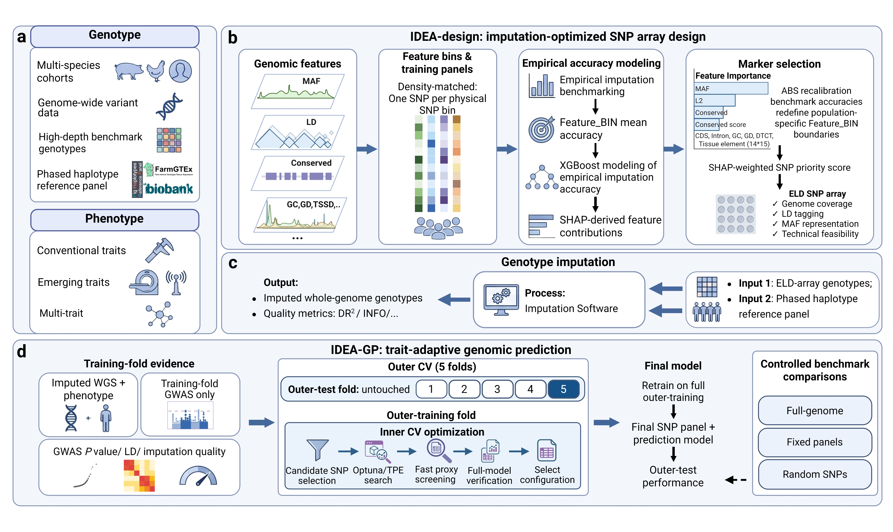

# IDEA: Imputation-Driven SNP Array Design and Trait-Adaptive Genomic Prediction

[](https://github.com/nariew111/IDEA/actions/workflows/tests.yml)
[](LICENSE)

**Design what to measure for genotype recovery; select what to predict with for each trait.**

IDEA connects sparse genotyping, genotype imputation and trait-adaptive genomic
prediction. It separates two related decisions: which SNPs to assay to support
the recovery of unmeasured variation, and which recovered markers to use for a
particular prediction task. This allows a common measurement panel to support
different phenotypes while the predictive marker set changes with the task.

| Component | Objective | Main inputs | Main outputs |
| --- | --- | --- | --- |
| **IDEA-design** | Select an imputation-oriented sparse SNP panel | Candidate-SNP features, population-specific feature-bin calibration, fixed feature weights and a marker budget | SNP IDs for panel design |
| **Imputation workflow** | Recover unassayed genotypes from sparse measurements | Sparse genotypes, a compatible phased reference panel and external imputation tools | Recovered genotypes and evaluation outputs |
| **IDEA-GP** | Select prediction markers separately for each phenotype | Genotypes, measured phenotypes, training-set association and LD evidence, and optional imputation-quality scores | Selected SNP sets, optimized settings and held-out prediction summaries |

[Installation](docs/installation.md) ·
[IDEA-design guide](docs/idea_design.md) ·
[IDEA-GP guide](docs/idea_gp.md) ·
[Data access](docs/data_availability.md) ·
[Weights and calibration](resources/idea_design/README.md) ·
[Reproducibility](docs/manuscript_reproducibility.md) ·
[中文入门](docs/quickstart_zh.md)

## Framework



[Open the full-resolution figure](assets/IDEA_framework.jpeg)

**Framework overview.** **a**, Genotype and phenotype resources.
**b**, IDEA-design: genomic features are evaluated against empirical imputation
performance, informing feature contributions and population-specific bin
priorities for marker selection. **c**, Genotype imputation connects sparse
measurements to a broader variant set. **d**, IDEA-GP uses training-fold evidence
to optimize trait-specific prediction-marker selection, followed by evaluation
on held-out individuals.

The figure describes the study workflow. The software provided here includes
feature preparation, prepared-feature selection, imputation/evaluation runners
and the IDEA-GP engine. The archived fixed weights and dated calibration
resources are provided under
[`resources/idea_design/`](resources/idea_design/README.md). Their provenance,
including the distinction between historical inputs and new reconstruction,
and remaining model-fitting materials are tracked in the
[reproducibility record](docs/manuscript_reproducibility.md).

## Study scope

The associated study evaluates IDEA across 20 pig, human and chicken populations,
with complementary analyses of imputation and downstream genomic applications.
Prediction evaluations include ten measured porcine traits and a chromosome-22
analysis of 51 traits in a base cohort of 25,000 UK Biobank participants.
The human analysis is a chromosome-22 benchmark; it should not be interpreted as
an evaluation of genome-wide human prediction performance.

The [IDEA-design web resource](https://alphaindex.zju.edu.cn/IDEA) provides
population-specific panel generation at user-specified marker counts.
The command-line package provides access to both IDEA-design and IDEA-GP.

## Installation

Use Python 3.9 or later. From a terminal:

```bash
git clone https://github.com/nariew111/IDEA.git
cd IDEA
python -m venv .venv
source .venv/bin/activate
python -m pip install -e ".[test]"
idea-design --help
idea-gp status
```

Alternatively, create the supplied Conda environment:

```bash
conda env create -f environment.yml
conda activate imputchip-idea
```

Full workflows also need external genomic executables and the chosen prediction
backend. See [installation and external tools](docs/installation.md).

## Quick start: a complete small selection example

From the repository root:

```bash
bash scripts/run_toy_idea_design.sh
```

Expected file: `results/toy/toy_selected_snps.txt`

```text
1_200
1_300
1_500
```

This example uses six manually specified artificial candidate SNPs, illustrative
weights and artificial feature-bin summaries. It requires no participant data,
reference panel or external genomic executable. It checks selection and package
operation; its weights and outputs are not the study's calibrated parameters or
biological performance results. See the [example description](examples/toy/README.md).

To choose another output location or interpreter:

```bash
OUT_DIR=/tmp/idea_toy_results PYTHON_BIN=python bash scripts/run_toy_idea_design.sh
```

## IDEA-design

Inspect the available commands:

| Command | Purpose |
| --- | --- |
| `idea-design generate-features --help` | Prepare feature tables from genomic inputs |
| `idea-design select --help` | Select markers from a population-folder layout |
| `idea-design run --help` | Access marker-count selection and the imputation/evaluation workflow |
| `idea-design accuracy --help` | Evaluate recovered genotypes |
| `idea-design run-legacy --help` | Access the earlier pipeline entry point |

To request a panel using prepared inputs without running imputation:

```bash
idea-design run \
  --feature-file path/to/population_features.tsv \
  --feature-weight path/to/feature_importance.csv \
  --summary-root path/to/population_calibration \
  --target-snp-total 10000 \
  --select-only \
  --select-out results/design/selected_snps.txt
```

`--target-snp-total` sets the total requested marker budget across the selected
chromosomes; `--target-snp-count` is a per-chromosome setting. The smaller
`select` command uses position bins, so its `--num-bins` option has a different
meaning. Input formats and both entry points are explained in the
[IDEA-design guide](docs/idea_design.md).

For the imputation/evaluation workflow, edit the input, output and external-tool
paths in `configs/idea.example.yaml`, then run:

```bash
idea-design run --config configs/idea.example.yaml
```

The supplied YAML contains a template for real analysis paths; it is not a
self-contained imputation benchmark.

## IDEA-GP

Prepare a PLINK binary prefix (`.bed`, `.bim`, `.fam`) and a whitespace-delimited
phenotype file with a header and columns `FID`, `IID`, `Pheno`. Supply one trait
per run. Optional imputation-quality information can be supplied separately.

```bash
idea-gp run --help

idea-gp run \
  --bfile path/to/genotypes \
  --pheno path/to/phenotypes.tsv \
  --out results/gp \
  --folds 5 \
  --inner_cv_folds 5 \
  --trials 20 \
  --method rrblup \
  --optuna_seed 2026
```

The equivalent argument template is:

```bash
bash configs/idea_gp.example.sh path/to/genotypes path/to/phenotypes.tsv results/gp
```

These commands require your authorized input data and the model's external
dependencies. They are usage examples, not the manuscript's fixed benchmark
configurations. The [IDEA-GP guide](docs/idea_gp.md) documents input examples,
cross-validation settings, optional quality scores, output locations and model
backends. A full redistributable genotype/phenotype demonstration is not yet
included in this snapshot.

## Fixed weights and calibration profiles

The [IDEA-design resource bundle](resources/idea_design/README.md) includes the
unchanged archived scoring weights, source-file hashes and 140 calibration
profiles spanning the study's 20 populations. There are two explicitly
distinguished records: the values selected by the historical summary reader,
and a new five-sample reconstruction dated 2026-11-13. The latter is not a
recovered original ABS and has not been used to rerun the biological benchmarks.

Export a new reconstruction profile into the selector's input format:

```bash
python scripts/export_calibration.py \
  --species pig --population D --density 1000 \
  --output-dir results/calibration/pig_D_1000
```

Use the exported `feature_importance1.csv` and feature-summary directory as
`--feature-weight` and `--summary-root`, together with compatible candidate
annotations. Here, `1000` identifies the archived representative-chromosome
density, not the total genome-wide panel size. The resource guide explains
available profiles, sample selection, feature-bin compatibility and the
explicit `--historical` export option.

## Available materials and reproducibility

This repository provides core software, installation metadata, usage guides,
example configurations, an artificial selection example, archived fixed weights
and documented calibration resources. Individual-level
UK Biobank and company-derived porcine data are accessed through their providers
and are not redistributed here. Reference-resource links and access routes are
listed in [Data resources and access](docs/data_availability.md).

The original five-sample ABS membership, frozen numerical feature-bin thresholds,
evaluated SNP lists and final analysis/plotting scripts still need to be matched
to the final study version. Their status is recorded explicitly in
the [study reproducibility record](docs/manuscript_reproducibility.md).
The artificial example parameters must not be substituted for those materials.

Run the package regression checks with:

```bash
pytest -q
```

These checks cover CLI entry points, small-example selection, resource integrity
and calibration export/reader compatibility. They do not
constitute a rerun of the biological imputation or prediction benchmarks.

## Repository layout

```text
assets/                   framework figure used on this page
src/idea/                 IDEA-design and preserved engine scripts
src/idea_gp/              IDEA-GP and preserved prediction engine
configs/                  IDEA-design YAML and IDEA-GP shell example
examples/toy/             artificial inputs and expected SNP list
resources/idea_design/    fixed weights, dated calibration and historical provenance
scripts/                  example runner, calibration export and reconstruction
tests/                    package regression checks
docs/                     guides, data access and reproducibility records
CITATION.cff              software citation metadata
LICENSE                   MIT software licence
```

Earlier ULDSuite and HAGSSuite names remain in some preserved engine comments
and runner output. The installed commands are `idea-design` and `idea-gp`.

## Citation and contact

The associated manuscript is **IDEA: An Imputation-Driven SNP Array Design and
Trait-Adaptive Genomic Prediction Framework**. Software citation metadata are
provided in [CITATION.cff](CITATION.cff). Cite the exact Git commit or published
release used for your analysis; a package version alone does not identify an
unchanging source snapshot. See [Code availability](docs/code_availability.md).

Please use [GitHub Issues](https://github.com/nariew111/IDEA/issues) for software
questions and bug reports. Include the command, package/commit version, tool
versions and an error log with participant identifiers and private paths removed.
Scientific correspondence: Zhe Zhang (`zhe_zhang@zju.edu.cn`) and
Yuchun Pan (`panyuchun1963@aliyun.com`).

The software is distributed under the [MIT License](LICENSE).
